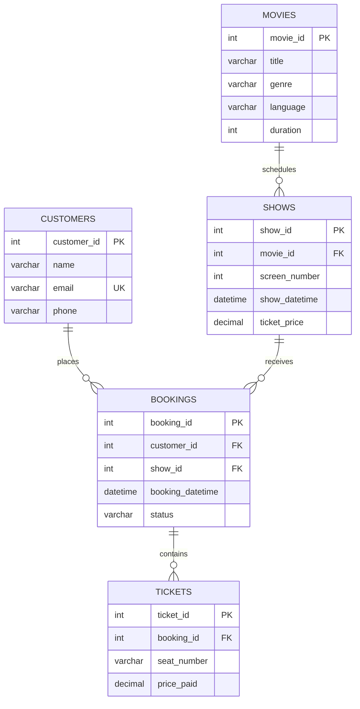

# 🎬 Movie Ticket Management System (SQL Project)

A MySQL database project for managing movie details, show schedules, customers, bookings, and ticket records. The project focuses on relational database design, constraints, and practical SQL queries for checking bookings and calculating ticket revenue.

## 📌 Project Overview

The database is named `project` and contains five core tables:

- **movies** – stores movie titles, genres, languages, and running times.
- **shows** – stores show schedules, screen numbers, and base ticket prices. Each show belongs to a movie.
- **customers** – stores customer contact details, with each email address required to be unique.
- **bookings** – connects a customer to a show and records the booking date and status.
- **tickets** – stores the seat number and amount paid for each ticket in a booking.

The SQL script also creates a temporary `notes` table to practise table alteration and data-manipulation commands. It is not part of the core ticket-management schema and is dropped later in the script.

## 🧰 Tech Stack

- **Database:** MySQL
- **SQL:** DDL, DML, SELECT queries, joins, aggregate functions, constraints, and transaction-control commands
- **Suggested tool:** MySQL Workbench

## 🗂️ Database Schema



### Relationships

- One movie can have multiple shows; each show refers to one movie.
- One customer can make multiple bookings; each booking refers to one customer.
- One show can be associated with multiple bookings.
- One booking can contain multiple tickets; each ticket belongs to one booking.

## 🔐 Constraints and Validation

| Table | Constraint / Rule |
|---|---|
| `movies` | Primary key on `movie_id`; duration must be between 60 and 240 minutes. |
| `shows` | Foreign key to `movies`; screen number must be between 1 and 3; ticket price must be greater than 0. |
| `customers` | Primary key on `customer_id`; email must be unique. |
| `bookings` | Foreign keys to `customers` and `shows`; status is limited to `Confirmed` or `Cancelled`; default status is `Confirmed`. |
| `tickets` | Foreign key to `bookings`; seat format is restricted to rows A–J and seats 01–12; price paid must be greater than 0; a seat number cannot be repeated within the same booking. |

## 📊 SQL Operations and Concepts Practised

- **Database and table creation:** `CREATE DATABASE`, `CREATE TABLE`, `SHOW TABLES`, `DESCRIBE`, and `SHOW CREATE TABLE`.
- **Data retrieval and filtering:** `SELECT`, `DISTINCT`, `WHERE`, `LIKE`, `BETWEEN`, `ORDER BY`, and `LIMIT`.
- **Aggregate queries:** `COUNT()` and `SUM()` with `GROUP BY`.
- **Joins:** `INNER JOIN` and `LEFT JOIN` for relating records and checking ticket references.
- **String functions:** `UPPER()`, `LOWER()`, `CONCAT()`, `CHAR_LENGTH()`, `SUBSTRING()`, `REPLACE()`, and `TRIM()`.
- **Data modification:** `INSERT`, `UPDATE`, and `DELETE`.
- **Schema modification:** `ALTER TABLE`, `TRUNCATE TABLE`, and `DROP TABLE` (demonstrated with the temporary `notes` table).
- **Data integrity:** primary keys, foreign keys, unique constraints, check constraints, defaults, and auto-increment columns.
- **Transaction-control practice:** `COMMIT` and `ROLLBACK` statements are included in the script.

## 📈 Example Analysis Queries

### Booking count by status

```sql
SELECT status, COUNT(*) AS bookings
FROM bookings
GROUP BY status
ORDER BY status;
```

### Confirmed ticket count and revenue

```sql
SELECT
    COUNT(*) AS confirmed_tickets,
    SUM(t.price_paid) AS net_ticket_revenue_inr
FROM tickets AS t
JOIN bookings AS b ON b.booking_id = t.booking_id
WHERE b.status = 'Confirmed';
```

### Find upcoming active seats

```sql
SELECT COUNT(*) AS active_seats
FROM bookings AS b
JOIN shows AS s ON b.show_id = s.show_id
WHERE b.status = 'Confirmed'
  AND s.show_datetime > NOW();
```

### Find movies in a selected language

```sql
SELECT movie_id, title, genre, language
FROM movies
WHERE language = 'Hindi';
```

These queries are also represented in the project SQL script, along with additional filtering, sorting, string-function, validation, and table-management examples.

## ⚙️ How to Run

1. Install MySQL Server and open MySQL Workbench (or another MySQL client).
2. Clone or download this repository.
3. Open `project_script.sql` in your SQL editor.
4. Run the initial database and table-creation statements. They create and select the `project` database and define the five core tables.
5. Import your corresponding CSV data into the tables using MySQL Workbench's **Table Data Import Wizard**, if you have the data files. The SQL script contains a comment indicating where CSV data was imported, but the CSV files are not embedded in the SQL script.
6. Run the validation and analysis queries after the data has been loaded.
7. Review the demonstration statements at the end of the script. Adjust or skip any demo inserts whose referenced IDs do not exist in your imported data.

You can also run the script from a terminal:

```bash
mysql -u your_username -p < project_script.sql
```

Run it against a test environment: the script includes statements that insert, update, delete, truncate, and drop data or tables.

## ⚠️ Notes and Scope

- The SQL file defines the schema and includes practice queries and demonstration statements; it is not a complete booking website or application.
- The later example booking insert uses fixed IDs (`customer_id = 58` and `show_id = 181`). Those records must exist, and the booking ID must be available, or the insert should be edited or skipped to avoid key conflicts.
- The ticket constraint prevents a repeated seat number within one booking. The current schema does **not** enforce seat exclusivity across separate bookings for the same show.
- The script calculates revenue from tickets linked to bookings whose status is `Confirmed`; it does not implement payment processing, refunds, or a cancellation workflow.
